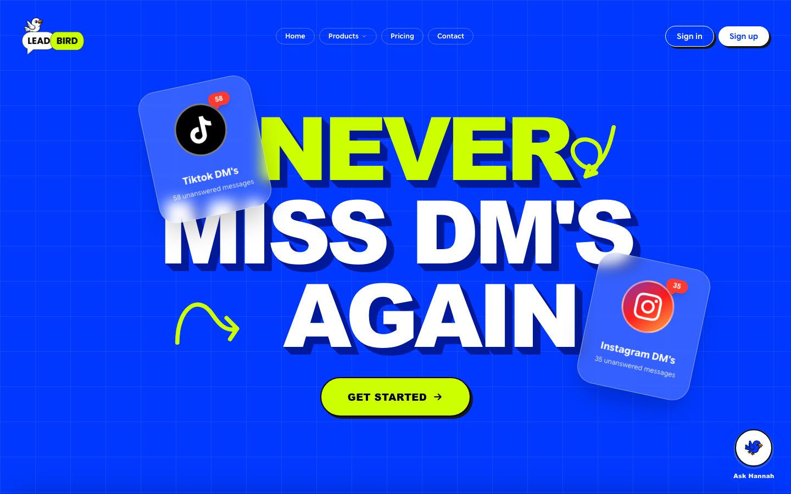
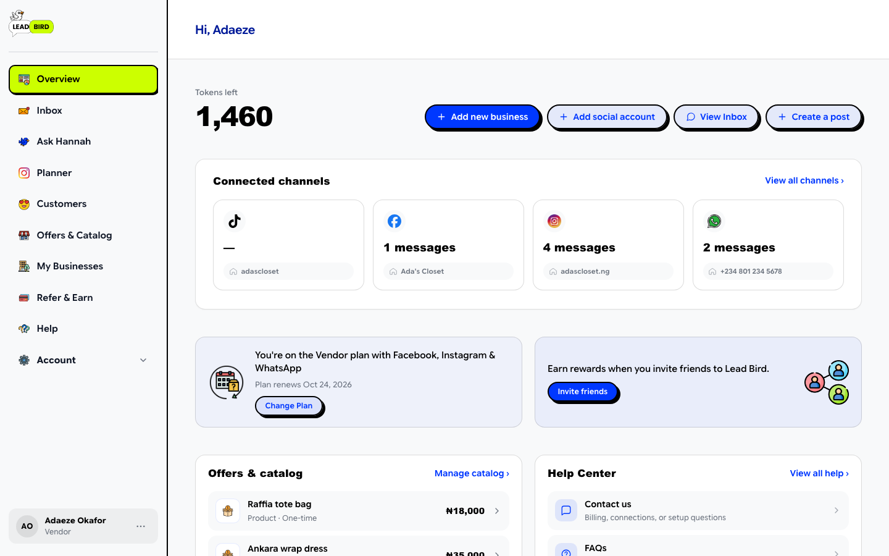
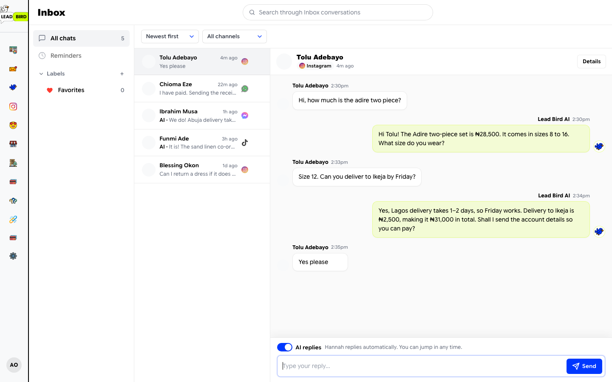
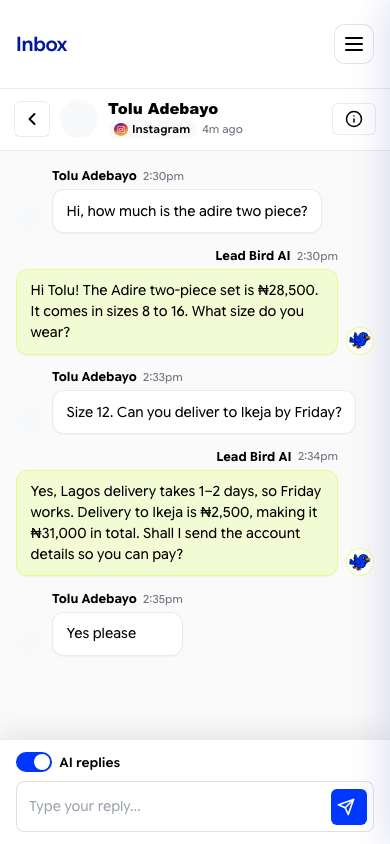
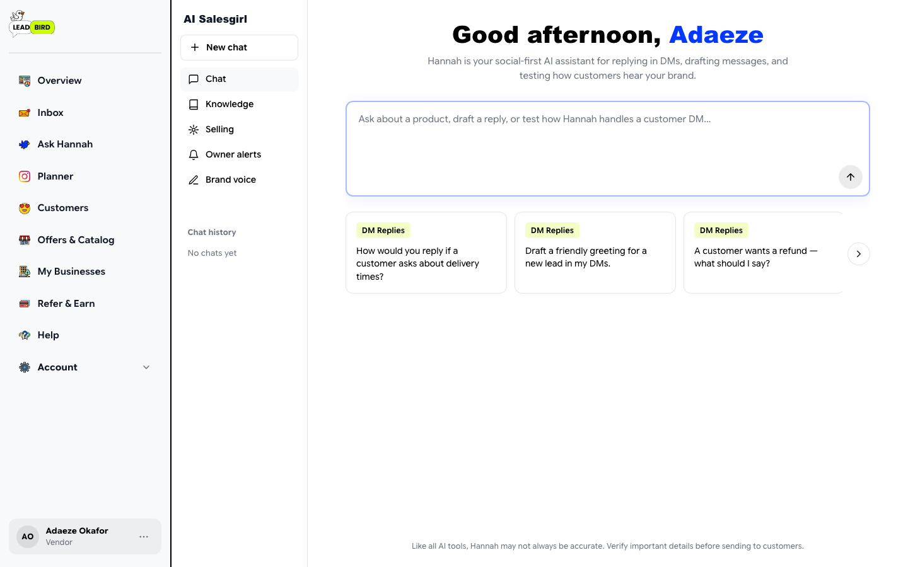
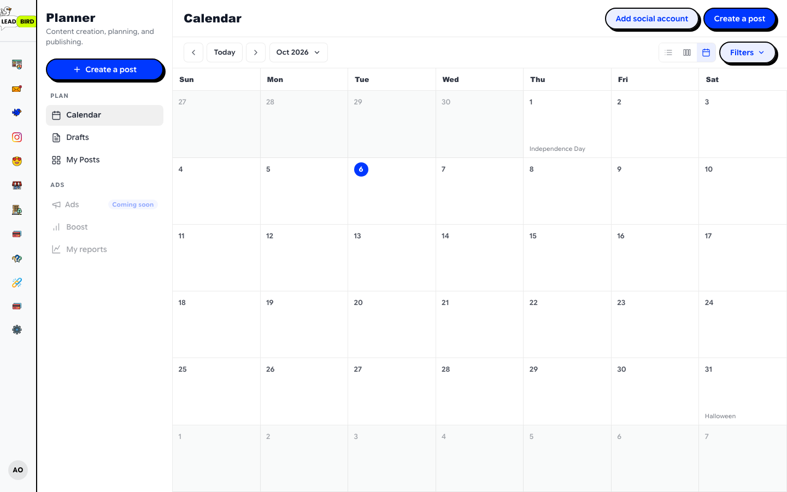
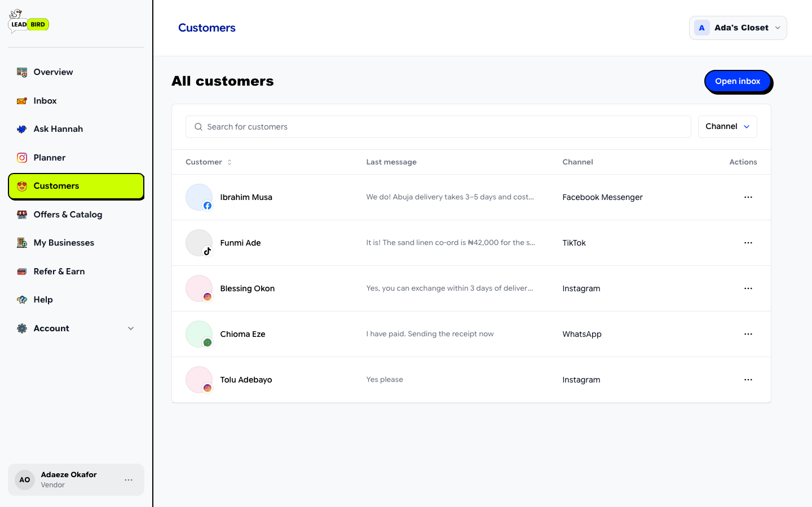
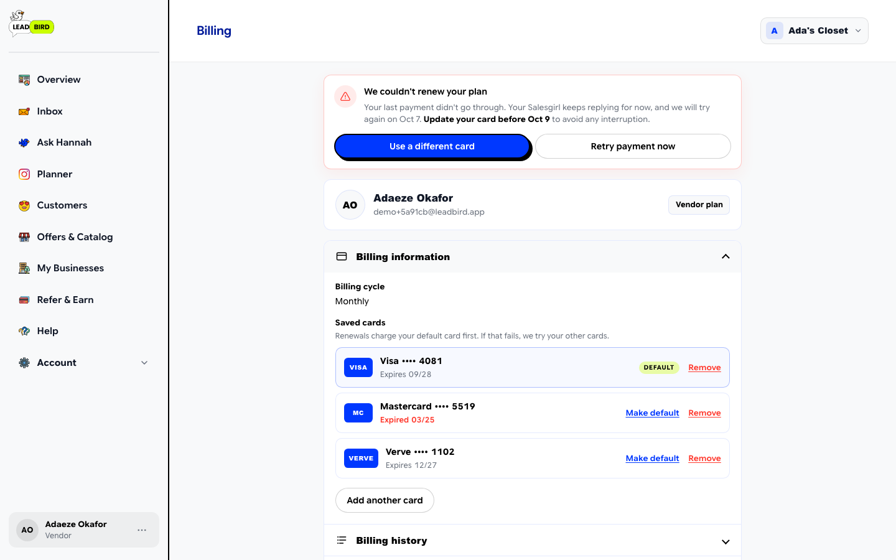
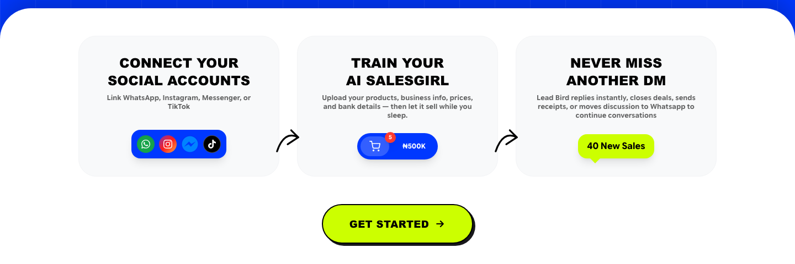

# Lead Bird

Lead Bird answers a small business's Instagram, Facebook Messenger and WhatsApp DMs for them. It quotes prices, sends product photos, handles delivery questions, books consultations, gives out payment details and tells the owner when a customer is ready to pay. It also schedules and publishes posts to Instagram, Facebook and TikTok.

It's live at [leadbird.app](https://leadbird.app) with paying customers. I built it on my own: product, backend, frontend, the Meta and TikTok app reviews, payments, and the hosting setup.



## Contents

- [Why it exists](#why-it-exists)
- [What it does](#what-it-does)
- [Stack](#stack)
- [How a DM gets answered](#how-a-dm-gets-answered)
- [Knowledge and retrieval](#knowledge-and-retrieval)
- [Billing, renewals and AI cost control](#billing-renewals-and-ai-cost-control)
- [Social media planner](#social-media-planner)
- [Everything else](#everything-else)
- [Security](#security)
- [Running on shared hosting](#running-on-shared-hosting)
- [Project layout](#project-layout)
- [Running it locally](#running-it-locally)
- [Tradeoffs and known gaps](#tradeoffs-and-known-gaps)

## Why it exists

Most small sellers in Nigeria, and a lot of them elsewhere, run their business through their DMs. They post a dress on Instagram and get forty messages asking "how much?", "do you deliver to Abuja?", "is size 12 available?". By the time the owner replies the next morning, half of those people have bought from someone else.

Lead Bird replies within seconds, around the clock, in the owner's tone, and only from what the owner has taught it. When a customer is ready to buy, it sends the account details, and when they send proof of payment it alerts the owner on WhatsApp. The owner can take over any conversation at any time.

## What it does

### Overview

The overview shows how much AI allowance is left this month, message counts for each connected channel, the current plan and renewal date, and shortcuts to the things owners do most: open the inbox, connect another account, or schedule a post.



### Inbox

One inbox covers every connected channel. The AI replies are shown in lime and the customer's messages in white. There is a per-conversation switch to turn AI replies off; sending a manual reply does that automatically so the AI doesn't talk over the owner. The inbox also has labels, reminders, search and channel filters.



It works on a phone too, which matters because most of our customers run their business from one.

<p align="center"></p>

### Ask Hannah

Hannah is the dashboard assistant. Owners can manage their store by chatting: "add a new product called linen co-ord at ₦42,000", "change my refund policy to 3 days", "how many leads did I get this week?". Under the hood it's OpenAI tool calling against about twenty actions (offerings, FAQs, policies, payment instructions, business profile, alerts, channel and business switching, knowledge sync).



### Planner

The planner schedules posts, reels, stories and carousels to Instagram, Facebook and TikTok. It can write captions and hashtags, and trim and crop video in the browser before upload.



### Customers

Every person who has messaged the business ends up here, with their channel and last message.



### Billing

Subscriptions renew from a saved card. If a renewal fails, the business keeps working through a grace period, the owner gets an email, and the page shows what happened and what to do about it.



### Onboarding

New accounts go through a six-step setup: connect channels, business profile, offers and services, FAQs and policies, payment instructions, and owner alerts. The goal was to get a business from sign-up to its first AI reply in one sitting.



## Stack

| Layer | Choice |
|---|---|
| Backend | PHP 8.2 with `strict_types` everywhere. No framework |
| Database | MySQL through PDO, using a repository layer (`lib/repositories`, about 40 repositories) |
| Frontend | Server-rendered PHP templates, Tailwind via CDN plus hand-written CSS, vanilla JS |
| AI | OpenAI: `gpt-4o-mini` for chat and vision, `text-embedding-3-small` for embeddings |
| Messaging | Meta Graph API (Messenger, Instagram, WhatsApp Cloud API) |
| Publishing | Meta Graph API and TikTok Content Posting API |
| Payments | Flutterwave (hosted checkout, tokenised card charges, transfers for affiliate payouts) |
| Email | Resend for OTPs, notices and the built-in webmail |
| Calendar | Google Calendar API for consultation bookings |
| Hosting | Hostinger shared hosting, deployed over SFTP |

The codebase is about 60k lines of PHP, 18k of JS and 31k of CSS.

**Why no framework?** The constraint was Hostinger shared hosting: no shell workers, no Redis, no long-running processes, and cron only through hPanel. I wanted something I could deploy by copying files, with no build step and nothing that assumes a container. Plain PHP with a thin repository layer, a static `RepositoryFactory` and extensionless routes in `.htaccess` turned out to be enough. Most of the real complexity is in the integrations, not in request handling.

## How a DM gets answered

```
Meta webhook ──► verify signature ──► 200 OK + fastcgi_finish_request()
                                             │
                                             ▼
                            ingest: resolve business, upsert customer,
                            open/find conversation, store message
                                             │
                                             ▼
                                 automation_queue (MySQL)
                                             │
                     ┌───────────────────────┴───────────────────────┐
                     ▼                                               ▼
        drained in the same request                       cron/process-queue.php
        (up to 10 jobs)                                   (every minute, 20 jobs)
                     └───────────────────────┬───────────────────────┘
                                             ▼
                                   process_inbound_message()
                                             │
           plan + token check ─► context ─► retrieval ─► LLM (JSON) ─► validate
                                             │
                                             ▼
                 reply + images / files / booking / owner alert / receipt
```

**Webhooks.** `webhooks/meta.php` handles Messenger and Instagram, plus WhatsApp when the payload is a `whatsapp_business_account` event. Every request is checked against `X-Hub-Signature-256` (HMAC-SHA256 of the raw body with the app secret, compared with `hash_equals`). Echo events are dropped so the AI never replies to itself.

**Acknowledge first, work later.** Meta retries webhooks that are slow to respond, and shared hosting gives you no background workers. So the endpoint returns `200` immediately, calls `fastcgi_finish_request()` to close the connection, and then keeps running: it ingests the events and drains a few queued jobs in the same PHP process. A cron hitting `cron/process-queue.php` every minute picks up anything left over.

**The queue** is a MySQL table with a JSON payload, status, attempt count and an `available_at` timestamp, indexed on `(status, available_at)`. Failed jobs retry after 60 seconds and stop after five attempts. Failures caused by business rules, such as an expired subscription, no tokens left or the plan's DM limit reached, are marked complete instead of failed so they don't keep retrying.

**Building the reply** (`jobs/process_message.php`):

1. Check that the subscription is active and there are tokens left. Skip if the owner has taken over the conversation.
2. Load the last 8 messages. `ConversationContextService` builds a retrieval query from the last six turns and a short memory block: what we already know about this customer, what the AI already promised them, and whether they've already said no to something.
3. Retrieve the six most relevant knowledge chunks (see below).
4. Call Chat Completions with `response_format: json_object` at temperature 0.35. The model returns a structured object: the reply text, a lead stage, whether to alert the owner, whether payment details should go out, which product images or documents to attach, and booking fields.
5. Validate the output on the server before anything is sent. Image URLs and attachment IDs must exist in what was retrieved or in the catalog, so the model can't invent a link. Replies that just echo the customer are blocked. If OpenAI is down or returns junk, a rule-based fallback reply goes out instead of nothing.

**Photos from customers.** When someone sends a picture and asks "do you have this?", text retrieval is usually useless. If the best text match is weak, a vision call compares the photo against up to 12 of the business's image-bearing chunks at `detail: low`, which is cheap, and adds the matches to the context.

**Owner alerts and handoff.** When a lead is ready to buy or sends proof of payment, an `owner_alerts` row is created and the owner gets a WhatsApp message on their escalation number. On the higher plans, the conversation can also be handed off to WhatsApp.

## Knowledge and retrieval

Everything the AI knows about a business lives in `business_knowledge_chunks`. The sources are:

- the business profile, FAQs and policies;
- every offering in the catalog (products, services, memberships, consultations, courses, events);
- the last 30 Instagram and Facebook posts, pulled nightly and auto-linked to matching offerings;
- website pages, from a crawler that reads `sitemap.xml` and same-host links, ranks paths like `/about`, `/menu` and `/faq` first, and takes the best ten;
- uploaded documents: PDFs are read with `pdftotext` when the host allows `exec`, otherwise with a pure-PHP Flate decoder, and images go through the vision model;
- learned memory: `ConversationLearningService` turns recent conversations that went well into new chunks.

**Retrieval is hybrid, and keyword-first on purpose.** Keyword scoring runs first. The query is only embedded when keyword matching is weak (top score under 4, or fewer than 2 hits). When it is, the final score is `0.65 × cosine + 0.35 × keyword`. On top of that there are FAQ boosts and rules that make sure a policy or FAQ makes it into the context when one is relevant. Most customer questions are things like "price?" or "delivery to Lekki?", which keywords answer fine, so skipping the embedding call saves money and latency on most messages.

**Vectors are stored as JSON in MySQL** and cosine similarity is computed in PHP. That is a deliberate shortcut. A single business has a few hundred chunks at most, so brute force is fast enough and I didn't have to run a vector database on shared hosting. It won't scale to large corpora; see [tradeoffs](#tradeoffs-and-known-gaps).

## Billing, renewals and AI cost control

**Plans.** Starter ($29), Vendor ($59) and Shop ($99) per month, with annual billing at ten times the monthly price. Each plan comes with a monthly token allowance and limits on businesses and channels. `PlanAccess` maps features to plans and `PlanLimits` enforces the counts.

**Currency.** Nigerian customers pay in naira and everyone else pays in dollars. Naira prices are worked out from the dollar price at the current Flutterwave rate. If the live quote fails, the code falls back to the last cached rate and then to a configured fallback. Renewals are re-priced the same way every time, so a naira subscriber isn't stuck on last year's exchange rate.

**Checkout** uses Flutterwave's hosted page, so card details never touch our server. Both the redirect callback and the webhook re-verify the transaction with Flutterwave's API and check that the reference, amount and currency match what we expected. The webhook body itself is never trusted.

**Renewals.** I first used Flutterwave payment plans for this. I replaced them with our own renewal engine, because running both meant a customer could be charged twice and we had no control over retries. The current flow:

- The card token from the first payment is saved.
- A daily run charges every subscription that is due. It tries the default card first, then any other saved cards. Whichever card works becomes the new default.
- If every card fails, the subscription goes into a five-day grace period and the business keeps working. We retry on day 2 and day 4, and the owner gets an email each time. After the last failure the subscription expires and the AI stops replying.
- Billing shows a past-due banner with "Retry payment now" and "Use a different card". Adding a new card retries the renewal straight away.

Because shared hosting only gives me HTTP cron, the daily run piggybacks on the ten-minute follow-ups cron. `SubscriptionRenewalRunner` takes a `flock` on a state file and records that the day's run has started *before* any card is charged. A crash halfway through therefore can't cause a second charge on the next tick.

**Tokens and AI budget.** Every AI action costs tokens from the plan allowance (a reply, a caption, an assistant chat), and owners can top up. Spending goes through a ledger keyed by reason and reference, so spending the same thing twice is a no-op. Separately, each business has a monthly dollar cap on OpenAI spend. Every OpenAI call checks month-to-date spend first, then records the real cost from the usage block, including the cached-input discount. A single runaway account can't run up the bill.

## Social media planner

- Posts are stored with per-target content, so the Instagram caption can differ from the TikTok caption for the same post.
- A one-minute job publishes posts that are due. Each target costs one token and is refunded automatically if publishing fails.
- **Meta:** Facebook photos, videos and feed posts. Instagram feed posts, reels, stories and carousels through media containers. Live posts can be edited or deleted.
- **TikTok:** the creator info and privacy level are checked first. Upload uses single-chunk `FILE_UPLOAD`, which avoids TikTok's verified-domain requirement for URL pulls, with `PULL_FROM_URL` as the fallback.
- **Video editing in the browser.** The server has no ffmpeg, so trim and crop-to-aspect-ratio run client-side with `ffmpeg.wasm`, re-encoded to H.264/AAC with `+faststart` before upload. Poster frames are also captured in the browser.
- Post insights come back from Instagram, Facebook and TikTok and are shown on the planner.

## Everything else

- **Follow-ups.** On the Shop plan, conversations that went quiet get a nudge after an owner-configured delay. It stops after the configured number of attempts, never fires while the owner has taken over, and never sends outside Meta's 24-hour messaging window.
- **Consultation booking.** The AI collects name, phone and preferred time in the conversation, then creates a Google Calendar event on the owner's calendar.
- **Negotiation.** Owners can allow discounts up to a maximum percentage, and the AI won't go past it.
- **Affiliates.** Referral links at `/r/CODE` with a 30-day cookie. 10% commission on the referred user's first subscription, held for 7 days, then paid out to a verified Nigerian bank account through Flutterwave transfers. Self-referrals are blocked. Failed payouts put the commission back to available.
- **Admin portal.** Users, businesses, subscriptions, tokens, channels, the queue, webhook logs, OpenAI usage, affiliates, disputes and feature flags. Admins can impersonate a user, suspend accounts, grant tokens and override subscriptions. Every admin action is written to an audit log.
- **Webmail.** `/mail` is a small standalone mail client for the team's `@leadbird.app` addresses, so we didn't have to pay per seat for Google Workspace. Sending goes through Resend, with scheduled sends that can be cancelled back to draft. Inbound mail arrives on a Resend webhook (Svix signature checked, with a 5-minute timestamp window) and is sorted into primary, promotions, social and updates. HTML mail is rendered in a sandboxed iframe.
- **Public site assistant.** The chat bubble on the marketing site answers questions about Lead Bird itself. It has its own budget and a rate limit.
- **Meta compliance.** Data-deletion and deauthorise callbacks, plus a provisioned reviewer account so Meta's App Review team can test the full product.

## Security

- CSRF tokens on every state-changing request; failures return 419. Return URLs are checked to block open redirects.
- Signatures are checked on every inbound webhook: Meta (HMAC-SHA256), Flutterwave (secret hash) and Resend (Svix).
- Sign-in is by email OTP or Google. OTPs are stored hashed, with expiry, an attempt limit and a resend cooldown. Google sign-in uses PKCE with server-side state.
- Sessions expire after 30 minutes idle or 12 hours total, with a warning in the browser before you're logged out.
- Per-IP sliding-window rate limits on OTP, billing, the assistants, contact forms and webmail login.
- `.htaccess` blocks web access to `lib`, `includes`, `scripts`, `jobs`, `database`, `logs` and `storage` internals, plus `.env` and `config.php`. Each of those folders also has its own deny-all file in case the root rules are ever changed. Uploaded customer knowledge files are never served directly.
- CLI scripts refuse to run over HTTP (`require_cli()`).

## Running on shared hosting

Most of the unusual decisions in this codebase come from running on Hostinger shared hosting. It's cheap and reliable, but there are no background workers, no queue service and no shell daemons.

| Problem | What I did |
|---|---|
| No background workers | `fastcgi_finish_request()` in webhooks, then do the work after the response is sent |
| No queue service | A MySQL-backed queue drained by webhooks and an HTTP cron |
| Cron only through hPanel, HTTP preferred | Token-guarded `cron/*.php` endpoints; daily jobs run inside the 10-minute cron behind a `flock` gate |
| No ffmpeg on the server | `ffmpeg.wasm` in the browser |
| `exec` not always allowed | Pure-PHP fallback for PDF text extraction |
| No Redis | File-based rate limiting and FX cache under `storage/` |
| No CI/CD on the host | `scripts/deploy.py` uploads the files you changed over SFTP and runs `php -l` on each one on the server |

Scheduled jobs:

| Job | When |
|---|---|
| `cron/process-queue.php` | every minute |
| `scripts/process-scheduled-posts.php` | every minute |
| `cron/process-followups.php` (also runs renewals once a day) | every 10 minutes |
| `scripts/refresh-fx-rate.php` | every 15 minutes |
| `scripts/release-affiliate-holds.php` | daily |
| `scripts/nightly-knowledge-sync.php` | 03:00 |
| `scripts/cleanup-social-media.php` | 03:15 |

## Project layout

```
├── *.php                 page entry points (dashboard.php, inbox.php, billing.php, ...)
├── lib/                  services and business logic (~80 classes)
│   └── repositories/     all SQL lives here
├── includes/             layouts, partials, bootstrap, Meta/OpenAI/WhatsApp helpers
├── jobs/                 queue job handlers (not web-reachable)
├── webhooks/             Meta, WhatsApp and Resend inbound endpoints
├── cron/                 token-guarded HTTP cron endpoints
├── scripts/              CLI jobs, migration runners, diagnostics, deploy.py
├── auth/ billing/ inbox/ onboarding/ social-media/ ...
│                         POST and JSON endpoints, grouped by feature
├── admin/                internal admin portal
├── mail/                 team webmail
├── config/               plans, token costs, top-ups
├── database/             base schema and numbered migrations
└── assets/               CSS, JS, images, vendored ffmpeg.wasm
```

Pages are thin. They load the session and business context, call one or two services and render a template from `includes/`. Services never write SQL directly; that stays in repositories.

## Running it locally

You need PHP 8.2+ (with `pdo_mysql`, `curl`, `mbstring`, `dom` and `fileinfo`) and MySQL 8 or MariaDB 10.6+.

```bash
git clone https://github.com/Choboy-dev/leadbird.git
cd leadbird
cp .env.example .env          # fill in DB credentials and APP_URL at minimum

mysql -u root -e "CREATE DATABASE leadbird CHARACTER SET utf8mb4 COLLATE utf8mb4_unicode_ci"
mysql -u root leadbird < database/mysql_schema.sql
for f in database/migrations/*.sql; do mysql -u root --force leadbird < "$f"; done

php -S localhost:8080
```

The migrations are written to be re-runnable, and `--force` skips past "already exists" errors where the base schema already has a table. Each one also has a `scripts/run-migration-NNN.php` runner that does the same thing through PDO, which is how they run in production.

Sign-in, the dashboard, the knowledge hub and the planner UI all work with only a database configured. Real AI replies need `OPENAI_API_KEY`. Receiving DMs needs a Meta app with a public HTTPS webhook URL (ngrok works). Payments need Flutterwave test keys. `.env.example` lists every setting with comments.

The routes are extensionless (`/dashboard`, `/inbox`) through `.htaccess`, which PHP's built-in server ignores. Locally, use `/dashboard.php` or run it behind Apache.

## Tradeoffs and known gaps

These are the things I'd fix first given time, or would do differently with a bigger budget than shared hosting.

- **Claiming queue jobs isn't atomic.** `claimPending` selects pending rows and then updates each one to `processing`, but it doesn't check whether the update actually claimed the row. A webhook drain and the cron running at the same instant could both process the same job. In practice the window is small and token spending is idempotent, so the worst case is a duplicate reply. The fix is to claim with `UPDATE ... WHERE status = 'pending'` and check `rowCount()`, or use `SELECT ... FOR UPDATE SKIP LOCKED` on MySQL 8.
- **Inbound message IDs aren't deduplicated.** If Meta re-delivers a webhook, the message is stored twice. Because we acknowledge immediately this is rare, but a unique key on the platform message ID would close it.
- **Vector search is brute force in PHP.** It's fine at a few hundred chunks per business, but it won't hold up at tens of thousands. The upgrade path is pgvector or a hosted vector store. The retrieval service is the only code that would change.
- **No automated test suite.** Billing and renewal logic was tested by running real scenarios inside database transactions that roll back, and there are diagnostic scripts in `scripts/` for the message pipeline. Unit tests around retrieval scoring, renewals and the reply validator would be my first addition.
- **Inbox updates by polling** every few seconds rather than over websockets, because shared hosting won't hold connections open. It's cheap because the sync endpoint only returns messages newer than the last one the browser already has.
- **No migrations table.** Migrations are idempotent and run by hand. That's fine for one developer, but it would need proper tracking with more than one.
- **TikTok is publishing only.** TikTok doesn't offer a DM API to apps like this one, so the AI can't reply there.

## A note on the code

This is production code that grew alongside the business, not a tidied-up sample. You'll find diagnostic scripts I wrote while debugging live issues with Meta, and a few large files (`SocialMediaService.php` is over 2,000 lines) that I'd split if I were starting over. Credentials, customer uploads, logs and deploy config are not in the repository.
